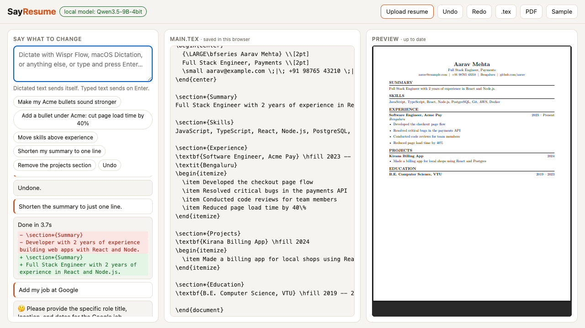

# SayResume

**Fix your resume by talking to it.** Upload a resume, say what to change, and watch the LaTeX source and the PDF update live. Pick **Local** (a model on your own Mac) or **Cloud** (a free hosted model) with one toggle.

Built for [No Hands: The Wispr Challenge](https://www.wemakedevs.org/wispr) (WeMakeDevs × Wispr Flow).

- **Live demo:** _add Vercel URL_ (Cloud mode only; Local needs the app on your own computer)
- **Demo video:** _add link_



## The problem

Updating a LaTeX resume for each application is slow: move a section, reword a bullet, escape a `%` that silently comments out the rest of the line, recompile, repeat. Resume builders hide the source; LaTeX gives control but costs time. SayResume keeps the LaTeX and removes the typing.

## What it does

| You say | What happens |
|---|---|
| "Make my Acme bullets sound stronger" | Rewrites those bullets, keeps the facts |
| "Add a bullet under Acme: cut page load time by 40 percent" | Adds `\item … 40\%` under the right job |
| "Move skills above experience" | Moves the section, nothing lost |
| "Add AWS and Docker to my skills" | Appends to the skills line |
| "Remove the projects section" | Deletes it cleanly |
| "Actually, undo that" | Instant undo (no model call) |
| "Add my job at Google" | Asks for title and dates instead of inventing them |

- **Upload anything:** `.tex` loads as-is. `.pdf`, `.docx`, `.txt`, `.md` are read **in your browser** (PDF.js is bundled, so no third-party CDN) and converted to LaTeX by the model.
- **Live view:** changed lines flash in the source pane, a red/green diff appears in the log, the PDF recompiles in about 0.2 s (locally).
- **Voice or keyboard:** speak into the command box with [Wispr Flow](https://wisprflow.ai) (hold Fn), macOS Dictation or anything else. Dictated text sends itself after a short pause; typed text sends on Enter. Nothing requires a particular dictation tool.
- **Versions in your browser:** the resume and its last 30 versions live in `localStorage`; the server stores nothing.

## Local vs Cloud

| | **Local** | **Cloud** |
|---|---|---|
| Model | Qwen3.5-9B (4-bit) via [oMLX](https://github.com/jundot/omlx) on your Mac | free OpenRouter models, with fallback if one is busy |
| Where your resume goes | nowhere: model and LaTeX compiler both run on your machine | the server (to compile) and OpenRouter (free models may log prompts) |
| Needs | Apple Silicon Mac, oMLX, `tectonic` | nothing; works on the hosted site |
| Speed | ~2–8 s per command | ~5–15 s, depends on the free model |

The toggle is in the header. On the hosted site **Local is disabled**: a cloud server can't reach your computer. Run the app yourself to use it.

## How the understanding layer works

```
spoken command ─► model (local or cloud)
                    │  replies with small SEARCH/REPLACE blocks and MOVE lines
                    ▼
                apply to the .tex ─► safety checks ─► compile (tectonic) ─► new .tex + PDF
                    ▲                     │
                    └── error goes back ──┘   (self-corrects, up to 3 tries)
```

- **Small edits, not rewrites.** The model only emits the lines it changes, so it cannot quietly drop content. Each `SEARCH` must match exactly one place (with whitespace tolerance for small-model drift).
- **Moves are done by code.** The model just says `MOVE: Skills BEFORE Experience`.
- **Guards.** Rejected if a section is duplicated, disappears without being asked, or the LaTeX no longer compiles. The failure goes back to the model, which retries.
- **No invented facts.** The prompt forbids new employers, dates, degrees, metrics or skills, and tells the model to ask (`NOCHANGE: <question>`) when a command is unclear.
- **LaTeX gotchas handled:** `40%` becomes `40\%` so it doesn't start a comment.

## Run it locally

```bash
brew install tectonic                 # LaTeX compiler
omlx start                            # local model server (needs Qwen3.5-9B-4bit in ~/.omlx/models)
cp .env.example .env                  # optional: add OPENROUTER_API_KEY to enable Cloud locally too
npm start                             # http://localhost:3000
```

No npm dependencies; Node 20+. Get the model from [mlx-community on Hugging Face](https://huggingface.co/mlx-community/Qwen3.5-9B-4bit) (about 6 GB) into `~/.omlx/models/mlx-community/`, then `omlx restart`. The first compile downloads TeX packages once (a few minutes), after that it is instant.

## Deploy to Vercel

```bash
npx vercel link
printf '%s' "$OPENROUTER_API_KEY" | npx vercel env add OPENROUTER_API_KEY production --sensitive
npx vercel --prod
```

How it works there: the build step (`scripts/prepare-tectonic.mjs`) downloads the Linux `tectonic` binary and pre-fills its package cache; the functions in `api/` copy that cache to `/tmp` on cold start and compile with it. `public/` is served as static files. Free OpenRouter models are rate limited (about 50 requests/day on a free account), and the server adds a per-IP limit, so heavy public traffic will run out; add OpenRouter credit to raise the cap.

## Tests

```bash
npm test      # edit engine + backends (model calls mocked, LaTeX compile is real) + DOCX extraction
```

`demo-voice/` holds nine spoken test commands (macOS TTS, Indian-English voices, with filler words) used to check the voice path end to end: speech → local Whisper transcript → app.

## Layout

```
lib/edits.mjs    pure text logic: parse/apply edits, move sections, guards
lib/engine.mjs   backends (local/cloud), compile, edit/import loops, HTTP handlers
api/*.mjs        thin Vercel functions (edit, import, compile, health)
local.mjs       local server: static files + the same handlers
scripts/         Vercel build step (tectonic binary + cache)
public/          UI (index.html, sayresume.js, extract.js, styles.css), sample.tex, vendored PDF.js
```

## Limits

- Cloud quality and speed depend on whichever free model is available; Local needs a Mac with enough memory for a 9B model.
- Importing a PDF/DOCX uses the model, so check the result. Scanned (image-only) PDFs aren't supported; RTF/ODT were dropped when text extraction moved into the browser.
- Imports use one fixed one-page LaTeX template; `.tex` uploads keep their own style.
